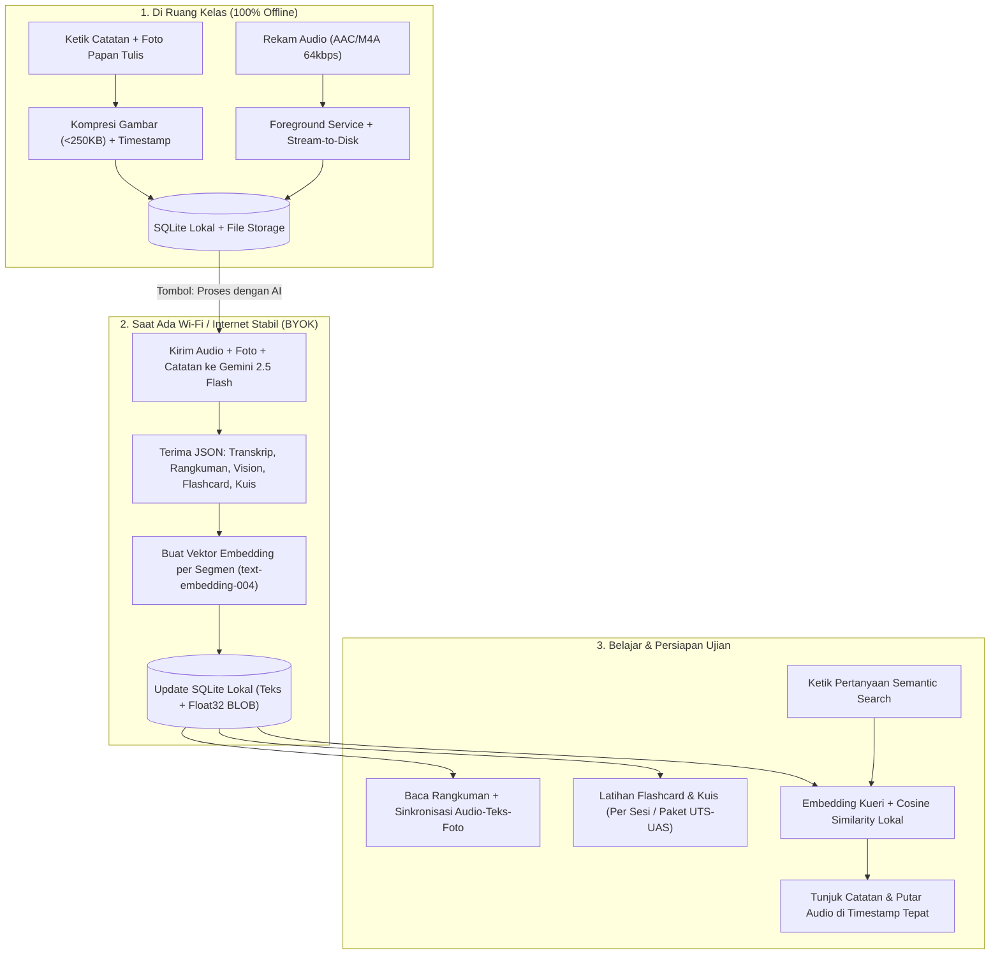

# Product Requirements Document (PRD) v2.0
**Nama Produk:** Myako — Smart Lecture Notes (Asisten Catatan Kuliah & Rangkuman Audio)  
**Platform:** Android (Flutter / Dart)  
**Target Perangkat Utama:** Xiaomi Redmi A2 (SoC MediaTek Helio G36, RAM 2GB/3GB, Storage 32GB/64GB eMMC 5.1, Android 12/13 Go Edition)  
**Tanggal:** 20 November 2026  
**Status:** Finalisasi Kebutuhan (Siap Review Sebelum Implementasi)

---

## 1. Informasi Dokumen & Visi Produk

### 1.1 Latar Belakang
Saat mengikuti perkuliahan tatap muka atau diskusi kelas, mahasiswa sering kehilangan informasi penting karena sulit membagi fokus antara mendengarkan penjelasan lisan dosen, melihat papan tulis/slide proyektor, dan menulis catatan secara bersamaan. Rekaman suara biasa memang menyimpan seluruh penjelasan, tetapi tidak praktis diputar ulang secara manual saat belajar menjelang UTS atau UAS.

### 1.2 Visi & Prinsip Produk
**Myako** adalah aplikasi asisten catatan kuliah berbasis Flutter yang dirancang dengan prinsip:
> **"Offline-First di Kelas, Multimodal Cloud AI saat Online, Ultra-Ringan di Redmi A2."**

1. **Zero-Friction di Kelas (Offline-First):** Mahasiswa dapat langsung merekam suara dosen, mengetik catatan singkat, dan memotret papan tulis/slide tanpa koneksi internet dan tanpa menguras baterai atau RAM.
2. **Pemrosesan Multimodal Pintar:** Saat terhubung ke Wi-Fi atau internet stabil, audio rekaman, foto papan tulis, dan catatan ketik diproses bersama oleh AI menjadi transkrip ber-timestamp, rangkuman terstruktur, flashcard, dan kuis latihan.
3. **Dioptimalkan untuk Android Go (Redmi A2):** Tidak menjalankan model AI berat di dalam HP (yang akan memicu *Out-of-Memory* atau *thermal throttling*), mengompresi audio dan gambar secara efisien, serta tahan terhadap *background process killer*.

---

## 2. Ringkasan Keputusan Hasil Wawancara (Locked Requirements)

Keputusan berikut telah dikunci berdasarkan dua tahap wawancara kebutuhan pengguna:

| Aspek | Keputusan Final | Implikasi Desain & Teknis |
| :--- | :--- | :--- |
| **Arsitektur AI & Backend** | **Tanpa Backend Server (BYOK — Bring Your Own Key)** | Menggunakan **Google Gemini API** (`gemini-2.5-flash` untuk pemrosesan multimodal audio + foto papan tulis + catatan manual, dan `text-embedding-004` untuk semantic search), dengan opsi tambahan **Groq API**. API Key disimpan secara terenkripsi di perangkat menggunakan `flutter_secure_storage`. |
| **Konektivitas di Kelas** | **Offline-First Recording → Manual Online Processing** | Proses rekam audio, catatan manual, dan foto papan tulis berjalan 100% offline. Pemrosesan AI dipicu manual melalui tombol **"Proses dengan AI"** saat user sudah mendapat koneksi Wi-Fi/internet stabil. |
| **Bahasa Kuliah** | **Indonesia + Istilah Teknis Inggris (*Code-Switching*)** | *System prompt* AI diinstruksikan khusus agar mengenali Bahasa Indonesia lisan yang bercampur dengan istilah akademik/teknis Bahasa Inggris tanpa salah koreksi. |
| **Organisasi Materi** | **Semester → Mata Kuliah → Sesi Pertemuan** | Struktur folder akademis yang rapi agar mudah mengelompokkan materi dan memilih cakupan soal ujian. |
| **Foto Papan Tulis / Slide** | **Kompresi Otomatis + Analisis Gemini Vision** | Foto dikompresi ke ~150–250 KB (maks. dimensi 1280px, JPEG/WebP), ditautkan ke menit-detik rekaman (*timestamp*), dan dikirim bersama audio ke Gemini Vision agar isi papan tulis ikut terbaca dan dirangkum. |
| **Latihan Ujian** | **2 Tingkat: Per Sesi & Paket UTS/UAS** | Tersedia Flashcard & Kuis untuk 1 sesi pertemuan, serta **Mode Persiapan UTS/UAS** untuk menggabungkan beberapa pertemuan dalam 1 Mata Kuliah menjadi 1 paket latihan terpadu. |
| **Tema Antarmuka (UI)** | **Dark Mode Default (+ Toggle Light Mode)** | Menggunakan tema gelap sebagai bawaan agar nyaman dipandang, tidak menyilaukan/mencolok di kelas, dan hemat daya layar, disertai sakelar menuju Light Mode di Pengaturan. |

---

## 3. Spesifikasi Fitur Lengkap (Functional Requirements)

### FR-01: Manajemen Semester & Mata Kuliah
- Pengguna dapat membuat dan mengelola daftar **Semester** (misal: *Semester 5 - Ganjil 2026*) dan **Mata Kuliah** di dalamnya.
- Setiap Mata Kuliah memiliki atribut: nama mata kuliah, kode/dosen pengampu (opsional), warna label pembeda, jumlah sesi pertemuan tersimpan, serta ringkasan jumlah flashcard/kuis siap uji.
- Mendukung operasi CRUD (Tambah, Ubah, Arsip/Hapus Mata Kuliah beserta seluruh sesinya).

### FR-02: Perekam Kuliah Offline & Upload Audio
- **Perekaman Langsung:**
  - Merekam audio dalam format **AAC / M4A (64 kbps, 16 kHz, Mono)** yang jernih untuk vokal manusia dan hanya memakan penyimpanan sekitar **25–28 MB per 1 jam kuliah**.
  - Menulis data audio langsung ke penyimpanan lokal (*stream-to-disk*) agar aman apabila baterai habis mendadak dan tidak membebani RAM.
  - Berjalan di atas **Android Foreground Service** lengkap dengan notifikasi persisten (menampilkan durasi berjalan & tombol jeda/berhenti) agar sistem Android Go tidak mematikan proses rekaman saat layar mati atau saat membuka aplikasi lain.
  - Menyediakan tombol **Tandai Penting (Bookmark Timestamp)** untuk menandai momen krusial selama rekaman.
- **Impor / Upload Audio Eksternal:**
  - Mendukung impor file audio dari penyimpanan HP (`.m4a`, `.mp3`, `.wav`, `.ogg`) seperti rekaman aplikasi *Voice Recorder* bawaan atau audio kiriman teman.
  - File impor disalin/ditautkan ke dalam Sesi Pertemuan pada Mata Kuliah terpilih agar tetap bisa diberi catatan tambahan dan diproses AI.

### FR-03: Catatan Ketik & Kamera Papan Tulis Berpenanda Waktu (*Timestamped Annotations*)
- Saat rekaman berlangsung (atau saat mengedit sesi audio yang diunggah), pengguna dapat menambahkan dua jenis anotasi yang otomatis terikat ke `timestamp_ms`:
  1. **Catatan Ketik Cepat (*Quick Note*):** Kolom teks ringkas untuk mencatat kata kunci, rumus, atau pengumuman dosen pada menit tertentu.
  2. **Foto Papan Tulis / Slide (*Whiteboard Capture*):** Tombol kamera langsung di layar rekaman (atau pilih dari galeri).
- **Optimasi & Kompresi Foto:** Setiap foto langsung dikompresi secara lokal sebelum disimpan (resolusi terpanjang maksimal **1280 px**, format JPEG/WebP kualitas ~75–80%, target ukuran **150–250 KB per foto**), sehingga 10 foto dalam satu kelas hanya memakan ~2 MB penyimpanan Redmi A2.

### FR-04: Pemrosesan AI Multimodal (Transkrip + Vision + Rangkuman)
- Pengguna menekan tombol **"Proses dengan AI"** pada sesi yang berstatus *Belum Diproses* ketika terhubung ke internet.
- Aplikasi mengirimkan paket konteks multimodal (file audio + foto papan tulis beserta keterangan timestamp-nya + catatan ketik manual) ke **Google Gemini API** (`gemini-2.5-flash`), atau opsi fallback ke **Groq API** untuk transkripsi cepat + LLM.
- Output terstruktur (JSON) yang dihasilkan dan disimpan ke database lokal:
  1. **Transkrip Berpenanda Waktu:** Teks lengkap perkuliahan yang dipecah per segmen (misal per 30–60 detik atau per pergantian topik) dengan `start_ms` dan `end_ms`.
  2. **Ringkasan Eksekutif (TL;DR):** Paragraf singkat gambaran inti pertemuan hari itu.
  3. **Poin-Poin Materi Utama:** Penjelasan konsep terstruktur per sub-topik.
  4. **Penjelasan Papan Tulis / Slide (Vision Synthesis):** Hasil pembacaan teks, diagram, atau rumus dari foto papan tulis yang digabungkan dengan konteks ucapan dosen pada menit tersebut.
  5. **Glosarium Istilah Teknis:** Daftar istilah Inggris/akademik yang muncul beserta definisi ringkas dalam Bahasa Indonesia.
  6. **Info Tugas & Ujian (*Action Items*):** Daftar tugas, tenggat waktu, atau kisi-kisi ujian yang disebutkan dosen.
- **Penanganan Status:** Jika koneksi terputus atau kuota API habis, status sesi tercatat jelas (*Gagal / Menunggu Jaringan*) tanpa menghapus audio, foto, maupun catatan asli.

### FR-05: Pemutar Audio Sinkron (*Audio-Text-Photo Sync*)
- Pada halaman detail sesi, tersedia pemutar audio mini yang menempel di bawah layar (kontrol Play/Pause, lompat -10s/+10s, kecepatan putar 1.0x / 1.25x / 1.5x / 2.0x).
- **Sinkronisasi Interaktif:**
  - Mengetuk segmen transkrip mana pun langsung mengarahkan pemutar audio (*seek*) ke `start_ms` segmen tersebut.
  - Mengetuk foto papan tulis atau *bookmark/catatan ketik* langsung memutar audio tepat pada menit-detik saat foto/catatan itu dibuat.

### FR-06: Generator Flashcard & Kuis + Mode Simulasi UTS/UAS
- **Tingkat 1 — Latihan Per Sesi Pertemuan:**
  - Saat pemrosesan AI selesai (atau dipicu ulang), AI menghasilkan **Flashcard** (Sisi Depan: Pertanyaan/Istilah, Sisi Belakang: Jawaban/Konsep) dan **Kuis Pilihan Ganda** (5–10 soal lengkap dengan 4 opsi dan penjelasan jawaban benar).
  - UI Flashcard mendukung interaksi balik kartu (*flip*) dan penilaian mandiri (*Sudah Paham* vs *Ulangi Lagi*).
  - UI Kuis menampilkan skor akhir dan pembahasan per soal.
- **Tingkat 2 — Mode Persiapan UTS/UAS (Lintas Pertemuan):**
  - Pengguna memilih sebuah **Mata Kuliah**, lalu memilih rentang pertemuan (misal Pertemuan 1–7 untuk UTS, atau Pertemuan 8–14 untuk UAS, atau pilih manual via *checkbox*).
  - Aplikasi menggabungkan flashcard dan bank soal kuis dari sesi-sesi terpilih menjadi satu sesi latihan terpadu (dengan opsi acak urutan dan jumlah soal, misal 10, 20, atau 30 soal).
  - *(Opsional/Lanjutan)* Pengguna dapat meminta AI menyusun paket soal baru lintas pertemuan berdasarkan rangkuman gabungan sesi yang dipilih.

### FR-07: Pencarian Berbasis Makna (*Semantic Search* Lokal)
- Pengguna mengetik pertanyaan dalam bahasa sehari-hari pada bilah pencarian global (atau di dalam satu Mata Kuliah), contoh: *"Apa perbedaan proses mitosis dan meiosis yang dijelaskan minggu lalu?"* atau *"Kapan tenggat pengumpulan laporan praktikum?"*.
- **Mekanisme Ringan & Cepat:**
  1. Saat pemrosesan AI pada suatu sesi selesai, setiap segmen transkrip dan ringkasan diubah menjadi vektor numerik (*embedding*) menggunakan `text-embedding-004` dan disimpan sebagai `BLOB` (`Float32List`) di SQLite lokal.
  2. Ketika pengguna melakukan pencarian, hanya teks kueri pertanyaan yang dikirim ke API embedding (berukuran sangat kecil, beberapa ratus byte) — atau fallback ke pencarian kata kunci lokal (SQLite `LIKE` / FTS) jika sedang sepenuhnya offline.
  3. Aplikasi menghitung **Cosine Similarity** di Dart terhadap seluruh vektor segmen di SQLite lokal (komputasi ringan <10 ms dan <5 MB RAM untuk ribuan segmen).
- **Tampilan Hasil:** Menampilkan daftar segmen paling relevan lengkap dengan skor kecocokan, nama Mata Kuliah, judul/tanggal pertemuan, cuplikan teks, serta tombol **"Putar di Menit Ini"** yang langsung membuka sesi dan memutar audio pada timestamp terkait.

---

## 4. Arsitektur Teknis & Skema Database Lokal (SQLite)

### 4.1 Diagram Alur Sistem & Data



### 4.2 Rekomendasi Stack & Paket Flutter
- **State Management:** `flutter_riverpod` (ringan, modular, mudah diuji).
- **Database Lokal:** `sqflite` + `path_provider` (penyimpanan persisten di disk, bukan memori).
- **Keamanan API Key:** `flutter_secure_storage` (menyimpan API Key Gemini/Groq menggunakan Android Keystore).
- **Audio & Background Service:** `record` (merekam AAC/M4A), `just_audio` (playback & *seek* akurat), `flutter_foreground_task` (menjaga rekaman tetap hidup saat layar Redmi A2 mati).
- **Kamera, File & Kompresi:** `image_picker`, `flutter_image_compress`, `file_picker`.
- **Networking:** `dio` (mendukung *timeout*, *retry*, upload multipart/File API Gemini untuk audio berdurasi 1–2 jam).
- **UI & Tema:** Material 3 dengan skema warna *Dark Mode* default dan tanpa `BackdropFilter` blur berat.

### 4.3 Skema Database SQLite Lokal

```sql
-- 1. Tabel Semester
CREATE TABLE semesters (
    id INTEGER PRIMARY KEY AUTOINCREMENT,
    name TEXT NOT NULL,
    is_active INTEGER NOT NULL DEFAULT 1,
    created_at TEXT NOT NULL
);

-- 2. Tabel Mata Kuliah
CREATE TABLE courses (
    id INTEGER PRIMARY KEY AUTOINCREMENT,
    semester_id INTEGER NOT NULL,
    name TEXT NOT NULL,
    lecturer_name TEXT,
    color_hex TEXT NOT NULL,
    created_at TEXT NOT NULL,
    FOREIGN KEY (semester_id) REFERENCES semesters (id) ON DELETE CASCADE
);

-- 3. Tabel Sesi Pertemuan Kuliah
CREATE TABLE lecture_sessions (
    id INTEGER PRIMARY KEY AUTOINCREMENT,
    course_id INTEGER NOT NULL,
    title TEXT NOT NULL,
    recorded_at TEXT NOT NULL,
    duration_ms INTEGER NOT NULL DEFAULT 0,
    audio_path TEXT NOT NULL,
    is_imported INTEGER NOT NULL DEFAULT 0,
    ai_status TEXT NOT NULL DEFAULT 'pending', -- pending | processing | completed | failed
    ai_error_message TEXT,
    summary_tldr TEXT,
    summary_points_json TEXT,
    whiteboard_synthesis TEXT,
    glossary_json TEXT,
    action_items_json TEXT,
    FOREIGN KEY (course_id) REFERENCES courses (id) ON DELETE CASCADE
);

-- 4. Tabel Anotasi Sesi (Catatan Manual, Foto Papan Tulis, Bookmark)
CREATE TABLE session_annotations (
    id INTEGER PRIMARY KEY AUTOINCREMENT,
    session_id INTEGER NOT NULL,
    type TEXT NOT NULL, -- text_note | photo | bookmark
    timestamp_ms INTEGER NOT NULL,
    content_text TEXT,
    image_path TEXT,
    ai_vision_notes TEXT,
    created_at TEXT NOT NULL,
    FOREIGN KEY (session_id) REFERENCES lecture_sessions (id) ON DELETE CASCADE
);

-- 5. Tabel Segmen Transkrip & Vektor Embedding (untuk Semantic Search)
CREATE TABLE transcript_segments (
    id INTEGER PRIMARY KEY AUTOINCREMENT,
    session_id INTEGER NOT NULL,
    start_ms INTEGER NOT NULL,
    end_ms INTEGER NOT NULL,
    text_content TEXT NOT NULL,
    embedding BLOB, -- Float32List hasil serialisasi vektor (ringan & cepat dibaca)
    FOREIGN KEY (session_id) REFERENCES lecture_sessions (id) ON DELETE CASCADE
);

-- 6. Tabel Flashcard
CREATE TABLE flashcards (
    id INTEGER PRIMARY KEY AUTOINCREMENT,
    session_id INTEGER NOT NULL,
    front_question TEXT NOT NULL,
    back_answer TEXT NOT NULL,
    mastery_level INTEGER NOT NULL DEFAULT 0, -- 0: baru, 1: perlu ulang, 2: paham
    FOREIGN KEY (session_id) REFERENCES lecture_sessions (id) ON DELETE CASCADE
);

-- 7. Tabel Soal Kuis Pilihan Ganda
CREATE TABLE quiz_questions (
    id INTEGER PRIMARY KEY AUTOINCREMENT,
    session_id INTEGER NOT NULL,
    question TEXT NOT NULL,
    options_json TEXT NOT NULL, -- Array 4 pilihan jawaban
    correct_index INTEGER NOT NULL,
    explanation TEXT NOT NULL,
    FOREIGN KEY (session_id) REFERENCES lecture_sessions (id) ON DELETE CASCADE
);
```

---

## 5. Optimasi Khusus Xiaomi Redmi A2 (Non-Functional Requirements)

Perangkat target **Redmi A2** memiliki keterbatasan spesifik (RAM 2–3 GB, Android Go Edition, chipset Helio G36, storage eMMC 32/64 GB). Berikut batasan teknis yang wajib dipenuhi selama pengembangan:

| Kategori | Target / Batasan | Strategi Implementasi |
| :--- | :--- | :--- |
| **Konsumsi RAM** | **< 150 MB** saat aktif & merekam | Tidak memuat seluruh file audio atau seluruh database ke RAM. Gunakan *streaming* disk untuk audio, *lazy loading* (`ListView.builder`) untuk daftar segmen transkrip panjang, dan bersihkan cache gambar (`PaintingBinding.instance.imageCache`) bila perlu. |
| **Penyimpanan (Storage)** | Audio **~25–28 MB/jam**; Foto **< 250 KB/foto** | Kunci encoder rekaman di `AAC-LC 64kbps 16kHz Mono`. Kompres foto papan tulis segera setelah diambil dan hapus file sementara kamera. Sediakan menu **"Bersihkan File Audio yang Sudah Dirangkum"** (opsional di Pengaturan) bila storage menipis. |
| **Ketahanan Background (Android Go)** | Rekaman tahan **> 2 jam** saat layar mati | Gunakan Foreground Service resmi Android (`RECORD_AUDIO` + `FOREGROUND_SERVICE_MICROPHONE`). Sertakan dialog bantuan satu kali (*onboarding*) untuk mengarahkan pengguna menonaktifkan pembatasan baterai (*Battery Optimization: Unrestricted*) khusus untuk aplikasi Myako. |
| **Kinerja UI & GPU** | Stabil **50–60 FPS** tanpa *frame drop* | Dilarang menggunakan `BackdropFilter` (blur kaca), bayangan berlapis yang berat, atau animasi Lottie berukuran besar. Gunakan warna solid Material 3 Dark Mode dan `RepaintBoundary` pada indikator gelombang suara. |
| **Ukuran APK** | **< 25 MB** saat dipasang di Redmi A2 | Build rilis wajib menggunakan `flutter build apk --release --split-per-abi` (hanya menyertakan arsitektur ARM Redmi A2). |
| **Pemrosesan Audio Panjang** | Audio **60–120 menit** tetap sukses diproses | Gunakan **Gemini Files API** (*resumable upload*) alih-alih mengirim base64 di JSON body (yang akan menyebabkan *Out-of-Memory* di Redmi A2). Jika koneksi tidak stabil, tampilkan progres unggahan bertahap. |

### 5.1 Keamanan Data & Privasi (Data Security & Privacy)

Untuk menjaga keamanan API Key pengguna serta kerahasiaan rekaman suara kuliah, foto papan tulis, dan catatan pribadi, aplikasi menerapkan 4 lapis perlindungan:

1. **Enkripsi Kredensial di Perangkat (Android Keystore):** Seluruh API Key (Google Gemini & Groq) disimpan terenkripsi menggunakan `flutter_secure_storage` dengan mode `EncryptedSharedPreferences` yang terikat pada Android Keystore perangkat — tidak pernah disimpan dalam file teks polos maupun `SharedPreferences` biasa.
2. **Isolasi Penyimpanan Lokal (*App-Private Sandbox*):** Database SQLite (`myako_secure_notes.db`), rekaman audio M4A, dan foto papan tulis disimpan di direktori privat aplikasi (`getDatabasesPath()` dan `getApplicationDocumentsDirectory()`) yang tidak dapat dibaca oleh aplikasi lain tanpa akses root.
3. **Pengamanan Jaringan & Android Manifest:**
   - `android:allowBackup="false"` dan `android:fullBackupContent="false"` untuk mencegah data catatan kuliah dan kredensial tersalin otomatis ke cloud backup yang tidak diinginkan.
   - `android:usesCleartextTraffic="false"` untuk memaksa seluruh komunikasi jaringan menggunakan HTTPS/TLS terenkripsi.
   - API Key Gemini dikirim melalui HTTP header `x-goog-api-key` (bukan pada URL query string) dan disanitasi agar nilai kunci mentah tidak pernah tercatat di log maupun pesan error UI.
4. **Perlindungan Repositori Git:** `.gitignore` dikonfigurasi secara ketat agar file kunci, `.env`, keystore rilis (`*.jks`, `key.properties`), database lokal (`*.db`, `*.sqlite`), dan file audio sampel tidak pernah ikut ter-commit ke GitHub.

---

## 6. Rancangan Layar (Screen Architecture)

1. **Layar Beranda (*Home / Mata Kuliah*):**
   - Bilah **Semantic Search** di bagian paling atas (*"Tanya materi kuliahmu..."*).
   - Filter Semester & daftar kartu **Mata Kuliah** (menampilkan jumlah pertemuan & status sesi yang belum diproses AI).
   - Tombol Aksi Cepat (*FAB*) **"Mulai Rekam Kuliah"** dan opsi **"Upload Audio"**.
2. **Layar Perekam Aktif (*Class Recorder Screen*):**
   - Tema gelap minim distraksi agar nyaman diletakkan di meja kelas.
   - Timer durasi besar, indikator level suara sederhana, tombol Pause/Resume/Stop.
   - Panel akses cepat di bagian bawah: **Ketik Catatan**, **Foto Papan Tulis (Kamera)**, dan **Bookmark Penting**, yang langsung menampilkan linimasa anotasi beserta waktunya.
3. **Layar Detail Mata Kuliah (*Course Detail & Exam Prep*):**
   - Daftar seluruh Sesi Pertemuan (beserta badge status: *Belum Diproses*, *Siap Dipelajari*, atau *Gagal*).
   - Tombol khusus **"Mode Persiapan UTS/UAS"** untuk memilih beberapa pertemuan dan langsung memulai latihan kuis/flashcard gabungan.
4. **Layar Detail Sesi Pertemuan (*Session Workspace*):**
   - Pemutar audio sinkron menempel di bawah.
   - Tab terorganisir:
     - **Rangkuman:** TL;DR, Poin Utama, Penjelasan Papan Tulis, Glosarium, Tugas/Ujian.
     - **Transkrip & Foto:** Linimasa gabungan transkrip ber-timestamp dan foto papan tulis (ketuk untuk putar audio pada detik tersebut).
     - **Flashcard & Kuis:** Mode belajar interaktif per sesi.
5. **Layar Hasil Semantic Search (*Search Results*):**
   - Menampilkan kartu hasil pencarian lintas mata kuliah atau per mata kuliah, menyoroti kutipan jawaban paling relevan, lengkap dengan tombol putar langsung pada timestamp terkait.
6. **Layar Pengaturan & API Key (*Settings*):**
   - Input & uji koneksi **Gemini API Key** (dan opsional **Groq API Key**).
   - Pengaturan Tema (**Dark Mode Default** / Light Mode).
   - Panduan pengaturan baterai Android Go agar rekaman anti-putus & informasi pemakaian ruang penyimpanan aplikasi.

---

## 7. Roadmap Implementasi Bertahap

| Fase | Ruang Lingkup Pekerjaan | Kriteria Selesai (*Done*) |
| :--- | :--- | :--- |
| **Fase 1: Fondasi & UI Dasar** | Inisialisasi proyek Flutter, setup tema Dark Mode (default) + Light Mode, skema SQLite lokal, CRUD Semester & Mata Kuliah, serta layar Pengaturan API Key (`flutter_secure_storage`). | Aplikasi bisa di-build, dibuka di Redmi A2, membuat Mata Kuliah, dan menyimpan API Key dengan aman. |
| **Fase 2: Perekam Offline & Catatan Papan Tulis** | Implementasi perekam AAC/M4A via Foreground Service, impor audio eksternal, input catatan manual, kamera foto papan tulis + kompresi gambar, dan penyimpanan ke SQLite. | Rekaman berjalan >1 jam saat layar Redmi A2 mati tanpa putus, foto terkompresi <250 KB dan terikat ke timestamp. |
| **Fase 3: Integrasi AI Multimodal & Sinkronisasi Audio** | Unggah audio via Gemini Files API + foto papan tulis + catatan manual ke `gemini-2.5-flash`, parsing JSON ke SQLite, tampilan tab Rangkuman/Transkrip, dan pemutar audio sinkron (`just_audio`). | Audio kuliah + foto papan tulis berhasil berubah menjadi rangkuman & transkrip, dan mengetuk teks/foto langsung memutar audio di detik yang tepat. |
| **Fase 4: Flashcard, Kuis & Mode UTS/UAS** | UI Flashcard interaktif (*flip & mastery*), UI Kuis pilihan ganda dengan pembahasan, serta fitur pemilihan lintas pertemuan untuk Paket Latihan UTS/UAS. | Pengguna dapat berlatih flashcard/kuis per pertemuan maupun gabungan beberapa pertemuan dalam 1 Mata Kuliah. |
| **Fase 5: Semantic Search & Uji Performa Redmi A2** | Pembuatan vektor embedding segmen (`text-embedding-004`), penyimpanan BLOB, pencarian Cosine Similarity di Dart + fallback offline keyword search, serta profiling RAM & ukuran APK `--split-per-abi`. | Pertanyaan natural mengembalikan potongan catatan yang relevan dalam hitungan milidetik, APK terpasang ringan dan lancar di Redmi A2. |
